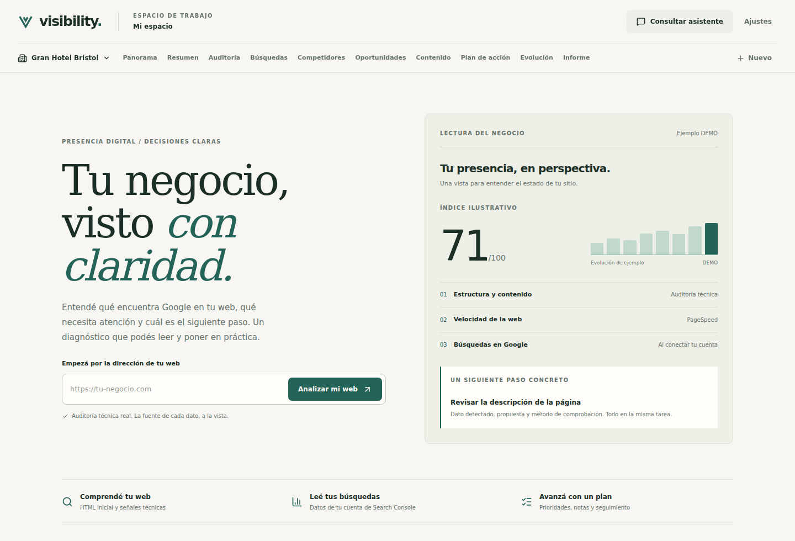

# Visibility: visual redesign

The interface uses a warm ivory canvas, dark green ink, and a restrained petrol accent. Manrope is the product typeface; Newsreader adds an editorial voice to the public page and sign-in introduction. A custom V mark and SVG favicon replace the generic search icon as the brand.

Guidance applied: [Taste Skill / redesign-existing-projects](https://github.com/Leonxlnx/taste-skill/blob/main/skills/redesign-skill/SKILL.md) and [Emil Kowalski / emil-design-eng](https://github.com/emilkowalski/skill/blob/main/skills/emil-design-eng/SKILL.md).

| Before | After | Why |
| --- | --- | --- |
| Mixed violet/blue accents and decorative gradients | One petrol accent with warm neutrals | A coherent product identity |
| Long permanent banners and notices | Compact, expandable data-source explanation | Keep the diagnosis visible without losing provenance |
| Generic search-icon wordmark | Custom V mark, wordmark and favicon | Consistent branding across entry and workspace |
| Oversized rounded containers and slow hover movement | Precise nested radii and brief color/press feedback | Clear hierarchy and responsive controls |
| Dashboard navigation retained the previous scroll position | Each module and business opens at the top | The new context is immediately visible |
| Small-screen connection button and task cards exceeded their container | Flexible button text and constrained task content | Avoid page-wide horizontal scrolling |

Real, partial, and DEMO labels remain visible. Assistant/content features still identify their purpose; no claim of human authorship is added. The OAuth configuration and database logic are unchanged.

## Validation

- TypeScript checking, production build and 33 existing tests pass.
- Browser checks: landing, dashboard, audit, searches, action plan, content, evolution, report, and sign-in/recovery at 320, 390, 1024 and 1440 pixels; no page-wide horizontal overflow or JavaScript errors.
- Business selection, saved task notes, connection diagnostics, assistant opening/closing, mobile menu and Escape tested locally.
- Reduced-motion preference checked. Table content keeps its own horizontal scroll.
- Browser checks used local demo data and stubbed API responses. They do not establish live Google/Supabase connectivity or actual mobile-device performance.

## Screenshots

The screenshots show illustrative DEMO data, not a new audit of a real site.

